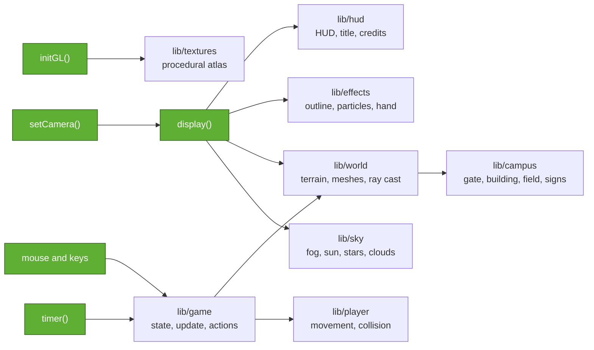

<div align="center">


### The Metropolitan University campus in Sylhet, rebuilt block by block in C++ and classic OpenGL

**Developed by Md Rejaul Korim Sadi** (231-115-349) **and Kazi Abu Jafor Arif** (231-115-068) · CSE 58th Batch<br>
CSE 402 Computer Graphics & Image Processing Lab · Metropolitan University, Sylhet


</div>

<br>

MetroCraft is a Minecraft-style sandbox set on our university's campus. You start on the entrance plaza with the pond and its ghat on your right and the white building on your left, walk under the **METROPOLITAN UNIVERSITY** gate past a row of flags, pass the **Centre For Excellence** on your right with its glass boxes and red tiled roof, and cross the playing field and its red running track to the main academic building. We built that one from a photo: a tall white concrete frame, a big solid wall of red brick on the left, a strip of dark windows up the middle, a white banner and a sunshade frame on the right, and the university's own name on a signboard on the roof. On the far side of the field, a scoreboard-style board reads **DEVELOPED BY SADI AND ARIF**. Around the campus the ground rises into green hills with rows of tea bushes, the way the hills sit around Sylhet.

Everything is made of blocks, so you can walk into the building, climb its stairs, fly over the field, break anything and build anything.

There are no image files and no model files anywhere in the source. All 30 textures are painted pixel by pixel when the program starts. The whole campus is placed by code, with loops that lay out floor slabs, columns, brick panels and window rows, and a tiny font table that writes the gate, the roof sign, the Centre For Excellence and the developer board in blocks.

The program you read first is **`src/main.cpp`, exactly 100 lines**: the window, the OpenGL settings, the camera, the draw order of a frame, the game loop and the input. Everything else lives in **`lib/`** as a small engine that `main.cpp` calls into.

<div align="center">

| Through the gate, then over the field | Build with campus blocks |
|:---:|:---:|
|  |  |
| **Day, sunset, night at the main building** | **The campus from above** |
|  |  |

</div>

## What's on the campus

| Place | What it's built from |
|---|---|
| **Entrance gate** | a white concrete beam on two pillars across the road, METROPOLITAN in black and UNIVERSITY in red, hedges and flowers |
| **Flags** | a row of white poles; the first flies the flag of Bangladesh |
| **Main academic building** | seven storeys modelled on the real one: a white concrete frame, a solid red brick panel on the left, a column of dark gridded windows in the middle, brick and window bands with a white MU banner on the right, a glass and open ground floor, real stairs up to the roof, and a white sunshade frame on the top right |
| **Roof signboard** | METROPOLITAN UNIVERSITY in red and black block letters on a white board standing on the roof |
| **Centre For Excellence** | first on the right inside the gate: a tall white frame of glass, a white wall with a red i and CENTRE FOR EXCELLENCE in green, a balloon arch over the door, a glass box hanging out on the right, a glass upper floor under a red tiled hip roof |
| **Developer board** | DEVELOPED BY / SADI AND ARIF on a white board on the west side of the field, facing it like a scoreboard |
| **Field and track** | a football pitch with white lines, centre circle and goals inside a red running track |
| **Pond** | just inside the entrance on the right of the road, with a concrete ghat stepping down into the water and palms around it |
| **White building** | a smaller two-storey block with window rows and red trim, on the left as you walk in |
| **Gazebo, palms, oaks** | a little pavilion with a green roof, palm trees along the plazas, oaks around the edges |
| **Hills** | noise-shaped hills all around, with rows of tea bushes on the slopes and caves and ore underneath |

## What's inside the engine

**Graphics**
- Procedural 16 × 16 pixel-art texture atlas, sampled with `GL_NEAREST` for the crisp blocky look
- Smooth ambient occlusion at block corners, the technique Minecraft popularised
- Rooms and caves get darker the deeper they are below the open sky
- Animated water, updated a few times a second with `glTexSubImage2D`
- Chunked rendering: 144 display lists, only faces next to air are drawn, only edited chunks rebuild
- Distance fog, underwater fog, a sun and moon, twinkling stars, drifting clouds

**Play**
- First-person camera with mouse look, walking bob and a wider field of view when you sprint
- Gravity, jumping, swimming, fly mode and box collision against the world
- Break with left click (with flying block particles), place with right click, pick a block with middle click
- The held block shows in your hand and swings when you use it
- Nine-slot hotbar with campus blocks (concrete, window, brick, running track, paint), debug info, controls panel
- Save and load the world, and save screenshots as BMP files

**Credits on screen**
- The DEVELOPED BY SADI AND ARIF board beside the field
- An animated title screen that circles the roof signboard, with the developer card for both of us
- A "developed by" popup when the game starts
- A developer badge that stays in the corner the whole time, and the full card again on the `I` key

<div align="center">

</div>

## Gallery

<div align="center">

| | |
|:---:|:---:|
|  |  |
| The gate from the entrance plaza, pond on the right | The main building, rebuilt from a photo |
|  |  |
| The developer board beside the field | The main building at night |
|  |  |
| The Centre For Excellence, on the right inside the gate | Its tiled roof and glass boxes |
|  |  |
| The pond and its ghat | The entrance at sunset |

</div>

## The code in two layers



Green boxes are the functions in `src/main.cpp`; the rest are files in `lib/`.

This is the whole frame, straight from `main.cpp`:

```cpp
void display() {
    clearSky();                                          // clear colour and depth buffers
    setCamera();
    drawSky();
    glEnable(GL_TEXTURE_2D);                             // solid blocks, with texture and alpha test
    glBindTexture(GL_TEXTURE_2D, game.atlas);
    glEnable(GL_ALPHA_TEST);
    game.world->drawOpaque(game.view.x, game.view.z);
    glDisable(GL_ALPHA_TEST);
    RayHit hit = lookAt();                               // the block under the crosshair
    if (game.screen == PLAYING) { drawSelection(hit); drawParticles(); }
    drawClouds();
    glEnable(GL_TEXTURE_2D);                             // water last, blended with what is behind it
    glEnable(GL_BLEND);
    glDepthMask(GL_FALSE);
    game.world->drawWater(game.view.x, game.view.z);
    glDepthMask(GL_TRUE);
    glDisable(GL_BLEND);
    drawOverlay(hit);                                    // 2D layer: HUD, or the title screen
    glutSwapBuffers();                                   // double buffering: show the finished frame
}```

## Controls

| Key | Action | | Key | Action |
|---|---|---|---|---|
| Mouse | Look around | | F | Fly on / off |
| W A S D | Move | | T | Day, sunset, night |
| Space | Jump, climb stairs, swim up, fly up | | F2 | Save a screenshot |
| Ctrl | Sprint | | F3 | Debug info |
| Shift | Fly down | | F5 / F9 | Save / load world |
| Left click | Break block | | N | New random world |
| Right click | Place block | | H or F1 | Controls panel |
| Middle click | Pick the block you look at | | I | About the developers |
| 1 to 9, wheel | Choose block | | Esc | Free mouse, again for the menu |

## Running it

### Windows with Code::Blocks

1. Download the repository as a ZIP (green **Code** button, then **Download ZIP**) and unzip it, or clone it:
   ```
   git clone https://github.com/RejaulKorimSadi/MetroCraft.git
   ```
2. Double-click **`open_in_codeblocks.bat`** inside the folder.
3. When Code::Blocks opens, press **F9**.

The freeglut headers and import library are already in the repository under `deps\`, so the project always compiles. The only thing the game needs at run time is `libfreeglut.dll`. The first time, the script installs Code::Blocks (with its MinGW compiler) and the freeglut package through `winget`, which takes a few minutes. After every build, Code::Blocks copies the DLL into `bin\` by itself. Nothing is copied into Program Files.

If Code::Blocks asks which compiler to use, pick **GNU GCC Compiler**. To run the world tests, switch the target drop-down from **Release** to **Tests** and press F9 again.

<details>
<summary>Setting it up by hand instead</summary>

1. Install Code::Blocks with MinGW (`codeblocks-25.03mingw-setup.exe` from codeblocks.org).
2. Install the freeglut DLL: install MSYS2, then run `pacman -S mingw-w64-ucrt-x86_64-freeglut`.
3. Open `MetroCraft.cbp` and press F9. The build copies `C:\msys64\ucrt64\bin\libfreeglut.dll` into `bin\`.

| Problem | Fix |
|---|---|
| `GL/freeglut.h: No such file or directory` | the `deps` folder is missing; unzip the whole repository again |
| "libfreeglut.dll was not found" when the game starts | install the freeglut package (step 2), or copy `libfreeglut.dll` into `bin` |
| "Can't find compiler executable" | install the Code::Blocks version with "mingw" in its name |

</details>

### Linux

```bash
sudo apt install g++ make freeglut3-dev
make run        # build and play
make test       # run the world tests
```

or with CMake: `cmake -S . -B build && cmake --build build && ctest --test-dir build`

## Reproducibility

The same seed always gives the same world, block for block. The campus is the same in every world; the seed changes the hills, caves and trees around it. The default seed is `20261028`, and you can pass another one when starting: `metrocraft 12345` (the seed shows on the title screen and in the F3 info).

`tests/world_test.cpp` checks this without opening a window. It builds the world twice and compares a fingerprint of all 2.9 million blocks, then checks the terrain, ores, caves, the campus landmarks, lighting, ray casting, and that a saved world loads back exactly.

```
MetroCraft world tests (seed 20261028)
  world fingerprint: 196F2779
  [PASS] the same seed builds the same world twice
  ...
  [PASS] the campus is there: field, road, pond, and the main building with its brick panel
  [PASS] the roof sign, the developer board, the gate and the Centre For Excellence are written in blocks
  [PASS] the Centre For Excellence has its tiled roof and glass upper floor
  ...
  reference fingerprint 196F2779: matches
all checks passed
```

The reference fingerprint was taken with GCC 13.3 on x86-64. A different compiler can round a float differently and produce a slightly different world. If that happens the test says so but doesn't fail.

Everything in `docs/media` was recorded from the game itself with seed `20261028` at 1280 × 720. On Linux, `tools/record.sh` does the same thing again: it starts the game on a virtual screen, replays a list of key presses and mouse moves, and saves the clip as a GIF (it needs Xvfb, xdotool and ffmpeg).

## How it works

| Graphics idea | Where to find it |
|---|---|
| Perspective projection | `gluPerspective` in `setCamera()`, `src/main.cpp` |
| Viewing transform | `glRotatef` and `glTranslatef` by the negative eye position, `setCamera()` |
| Orthographic 2D overlay | `gluOrtho2D` in `ortho()`, `lib/hud.cpp` |
| Modelling with primitives | every block is 6 faces of 2 triangles, `emitFace()` in `lib/world.cpp` |
| Procedural modelling | the campus built by loops in `lib/campus.cpp` |
| Texture mapping, atlas UVs | `buildAtlas()`, `tileUV()` in `lib/textures.cpp` |
| Texture animation | `animateWater()` with `glTexSubImage2D`, `lib/textures.cpp` |
| Hidden-surface removal | depth test and culling in `initGL()`, `faceVisible()` in `lib/world.cpp` |
| Ambient occlusion | `cornerAO()` in `lib/world.cpp` |
| Transparency | alpha test for leaves, glass and plants, blending for water, both in `display()` |
| Billboards | particles turned to face the camera in `drawParticles()`, `lib/effects.cpp` |
| Retained-mode geometry | one display list per chunk per pass, `lib/world.cpp` |
| Picking | `World::raycast()` voxel traversal, called from `mouseButton()` |
| Vector and bitmap text | `glutStrokeString` for titles, `glutBitmapString` for the HUD, `lib/hud.cpp` |

The full walkthrough, from "what is OpenGL" to every function in the project, is in **[docs/GUIDE.md](docs/GUIDE.md)**.

To find the code behind any shape on screen (a cube, the building, the gate letters, the track, particles, the sun, the hotbar icons, the logo), see the **[code map](docs/CODE_MAP.md)**. It lists every shape with its OpenGL primitive, file and line.

## Project layout

```
MetroCraft/
├── src/
│   └── main.cpp              the 100 lines: window, OpenGL setup, camera, frame, loop, input
├── lib/                      the engine main.cpp calls into
│   ├── campus.h / .cpp       the campus: gate, main building, Centre For Excellence, signs, field, track, pond, flags, trees
│   ├── world.h / .cpp        block grid, campus ground and hills, caves, ore, meshes, lighting, ray cast, save/load
│   ├── game.h / .cpp         shared state, world start, per-frame update, key actions
│   ├── player.h / .cpp       movement, gravity, swimming, collision
│   ├── textures.h / .cpp     procedural texture atlas and water animation
│   ├── sky.h / .cpp          sky colour, fog, sun, moon, stars, clouds
│   ├── effects.h / .cpp      block outline, break particles, the block in your hand
│   ├── hud.h / .cpp          HUD, title screen, developer credits, screenshots
│   ├── blocks.h              block types and their textures
│   └── noise.h               2D and 3D value noise
├── tests/world_test.cpp      reproducibility, world and campus checks
├── tools/record.sh           re-records the GIFs from the game
├── docs/
│   ├── GUIDE.md              the complete guide
│   ├── CODE_MAP.md           which file and line draws each shape
│   └── media/                banner, GIFs and screenshots
├── deps/                     freeglut headers and import library for Windows builds
├── open_in_codeblocks.bat    one double-click to set up and open on Windows
├── MetroCraft.cbp            Code::Blocks project (Release and Tests targets)
├── CITATION.cff              how to cite this project
├── CMakeLists.txt
├── Makefile
└── LICENSE
```

## References

- John Amanatides and Andrew Woo, *A Fast Voxel Traversal Algorithm for Ray Tracing*, Eurographics 1987. Used for block picking.
- Mikola Lysenko, [*Ambient occlusion for Minecraft-like worlds*](https://0fps.net/2013/07/03/ambient-occlusion-for-minecraft-like-worlds/), 0fps.net, 2013. Used for the corner shadows and the quad-flip rule.
- [freeglut](https://freeglut.sourceforge.net/), for the window, input and fonts.

## Authors

| | |
|---|---|
| **Md Rejaul Korim Sadi** | ID 231-115-349 · CSE 58th Batch, Section I |
| **Kazi Abu Jafor Arif** | ID 231-115-068 · CSE 58th Batch |

Department of Computer Science & Engineering, Metropolitan University, Sylhet.

Course: CSE 402 Computer Graphics & Image Processing Lab. Course teacher: Shrabanti Chowdhury, Lecturer, Department of EEE.

MetroCraft is a student project. The campus is our own block-by-block interpretation of Metropolitan University, Sylhet, made for a course at the university; it is not an official university product. The game is inspired by Minecraft by Mojang Studios, is not affiliated with or endorsed by Mojang or Microsoft, and uses none of their code, textures or assets. Released under the MIT License.
