<div align="center">



### Our university campus in Sylhet, rebuilt one block at a time in C++ and classic OpenGL

**Md Rejaul Korim Sadi** (231-115-349) &nbsp;·&nbsp; **Kazi Abu Jafor Arif** (231-115-068)<br>
CSE 402 Computer Graphics & Image Processing Lab · Metropolitan University, Sylhet


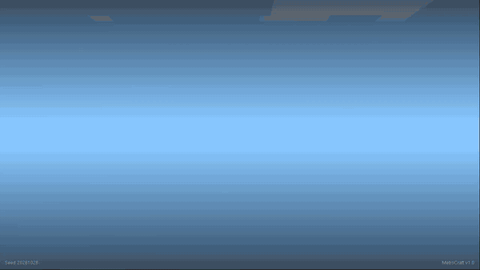

[**The campus**](#the-campus-from-above) · [**Engine**](#whats-inside-the-engine) · [**Gallery**](#gallery) · [**Code**](#how-the-code-is-laid-out) · [**Run it**](#running-it) · [**Reproducibility**](#reproducibility) · [**Guide**](docs/GUIDE.md) · [**Code map**](docs/CODE_MAP.md)

</div>

<br>

You spawn on the entrance plaza. The pond and its concrete ghat are on your right, the white building with red trim is on your left, and ahead of you the **METROPOLITAN UNIVERSITY** gate spans the road. Walk through it and the **Centre For Excellence** is the first thing on your right, glass boxes and a red tiled roof. Keep going across the field and the red running track and you reach the main academic building, which we rebuilt from a photo: a white concrete frame, a solid wall of red brick, a strip of dark windows up the middle and the university's name on a signboard on the roof. On the far side of the field a scoreboard reads **DEVELOPED BY SADI AND ARIF**. Past the campus edge the land climbs into green hills with rows of tea bushes, the way it does around Sylhet.

All of it is blocks. You can walk into the buildings, climb the stairs to the roof, fly over the field, dig into the caves under the hills, and break or build anything.

<div align="center">

| `src/main.cpp` | Textures | Image or model files | Blocks in the world | World tests |
|:---:|:---:|:---:|:---:|:---:|
| **exactly 100 lines** | **30**, painted in code | **none** | **2.9 million** | **15**, all passing |

</div>

<div align="center">

| Walk through the gate, then fly to the main building | Break and build with campus blocks |
|:---:|:---:|
| 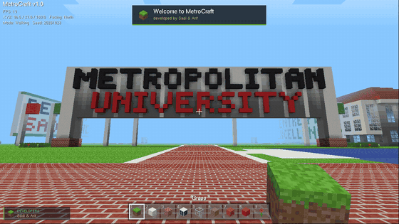 | 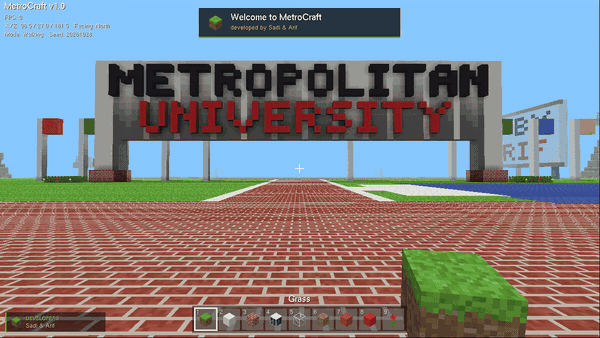 |
| **Day, sunset and night at the main building** | **The Centre For Excellence, right inside the gate** |
| 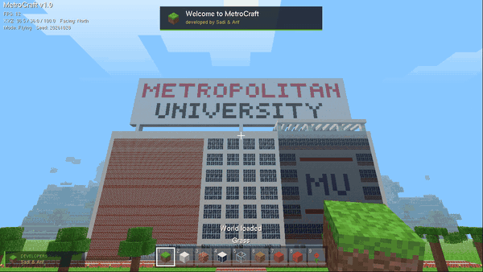 | 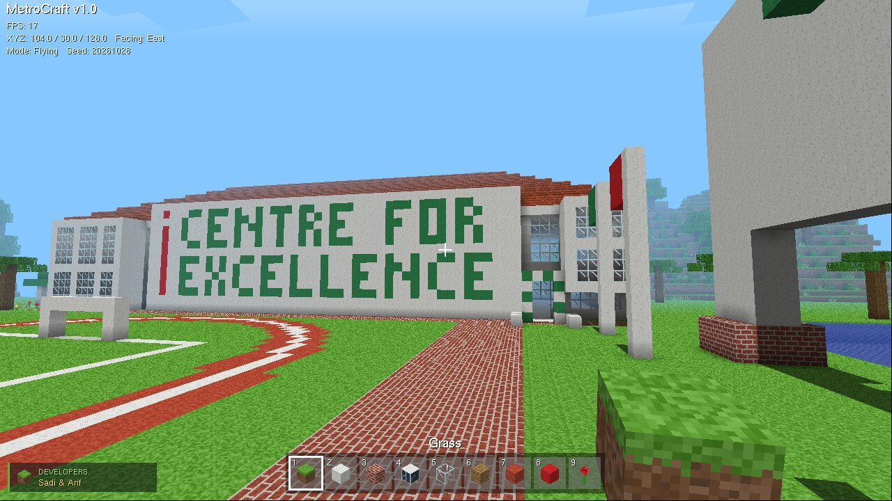 |

</div>

## The campus from above

<table>
<tr>
<td width="56%">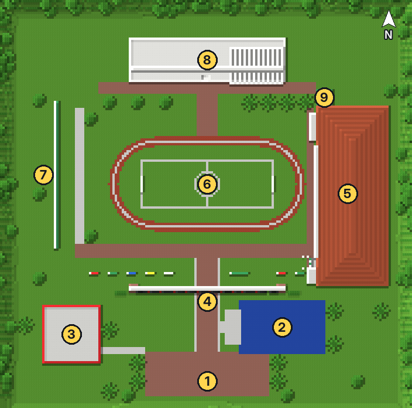</td>
<td>

| # | Stop |
|:---:|---|
| **1** | Entrance plaza, where you spawn |
| **2** | Pond and its concrete ghat |
| **3** | White building with red trim |
| **4** | METROPOLITAN UNIVERSITY gate and the flags |
| **5** | Centre For Excellence |
| **6** | Football field and running track |
| **7** | DEVELOPED BY SADI AND ARIF board |
| **8** | Main academic building and its roof sign |
| **9** | Gazebo with a green roof |

This map isn't drawn by hand. It's the top block of every column in the default world, each one coloured with its own in-game texture, so it shows exactly what you'll walk on.

</td>
</tr>
</table>

<details>
<summary><b>What every place is built from</b></summary>
<br>

| Place | Built from |
|---|---|
| **Entrance gate** | a white concrete beam on two pillars across the road, METROPOLITAN in black and UNIVERSITY in red, hedges and flowers at its feet |
| **Flags** | a row of white poles; the first flies the flag of Bangladesh |
| **Centre For Excellence** | a tall white frame full of glass, a white wall with a red **i** and CENTRE FOR EXCELLENCE in green, a balloon arch over the door, a glass box hanging out on the right, a glass upper floor and a red tiled hip roof |
| **Main academic building** | seven storeys: a white concrete frame, a solid red brick panel on the left, a column of dark gridded windows in the middle, brick and window bands with a white MU banner on the right, a glass and open ground floor, real stairs up to the roof, and a white sunshade frame on the top right |
| **Roof signboard** | METROPOLITAN UNIVERSITY in red and black block letters on a white board standing on three legs |
| **Developer board** | DEVELOPED BY / SADI AND ARIF on a white board on the west side of the field |
| **Field and track** | a football pitch with white lines, a centre circle and goals inside a red running track |
| **Pond** | right of the road at the entrance, with a concrete ghat stepping down into the water and palms around it |
| **White building** | a smaller two-storey block with window rows and red trim, on the left as you walk in |
| **Gazebo, palms, oaks** | a little pavilion with a green roof, palms along the plazas and the front lawn, oaks around the edges |
| **Hills** | noise-shaped hills all around, with tea rows on the slopes and caves and ore underneath |

</details>

## What's inside the engine

<table>
<tr>
<td valign="top" width="33%">

**Graphics**
- 16 × 16 pixel-art texture atlas, painted in code, sampled with `GL_NEAREST`
- Smooth ambient occlusion at block corners
- Rooms and caves get darker the further they are from open sky
- Animated water through `glTexSubImage2D`
- Chunked display lists; only faces that touch air are drawn
- Distance fog, underwater tint, sun, moon, twinkling stars, drifting clouds

</td>
<td valign="top" width="33%">

**Play**
- First-person mouse look with walking bob and a wider view when sprinting
- Gravity, jumping, swimming, flying and box collision
- Break (with particles), place, and pick a block with the middle button
- The held block swings in your hand
- Nine-slot hotbar of campus blocks, controls panel, debug info
- Save and load the world, BMP screenshots

</td>
<td valign="top" width="33%">

**Credits, always on screen**
- Title screen that circles the roof signboard, with a card for both developers
- "Developed by Sadi & Arif" popup when a game starts
- A developers badge in the corner the whole time
- The full card again on the `I` key
- The DEVELOPED BY SADI AND ARIF board, made of real blocks

</td>
</tr>
</table>

<div align="center">
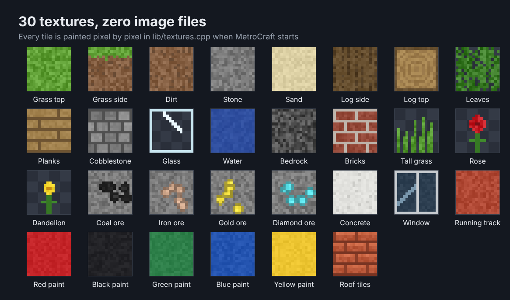
</div>

## Gallery

<div align="center">
<table>
<tr>
<td align="center">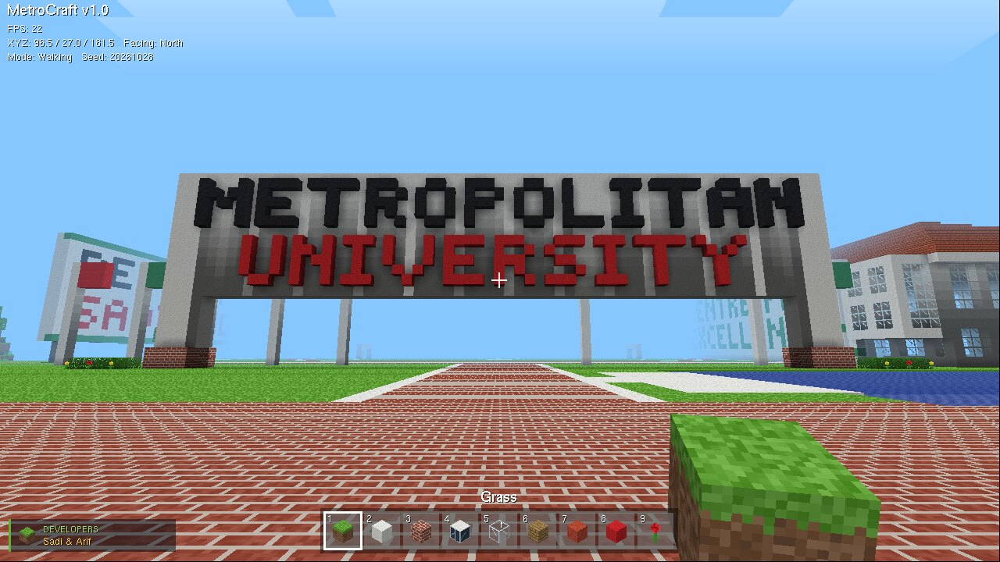<br><sub>The gate from the entrance plaza, pond on the right</sub></td>
<td align="center">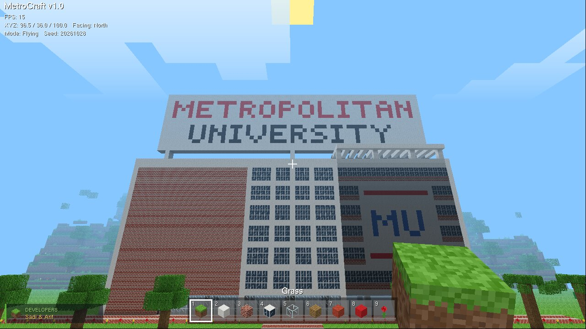<br><sub>The main building, rebuilt from a photo</sub></td>
</tr>
<tr>
<td align="center">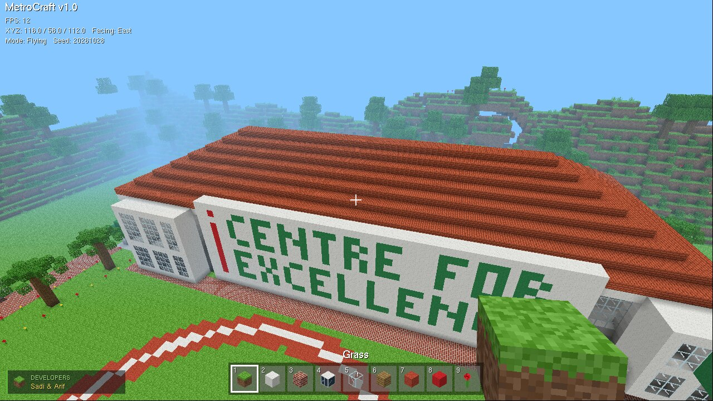<br><sub>The Centre For Excellence and its tiled roof</sub></td>
<td align="center">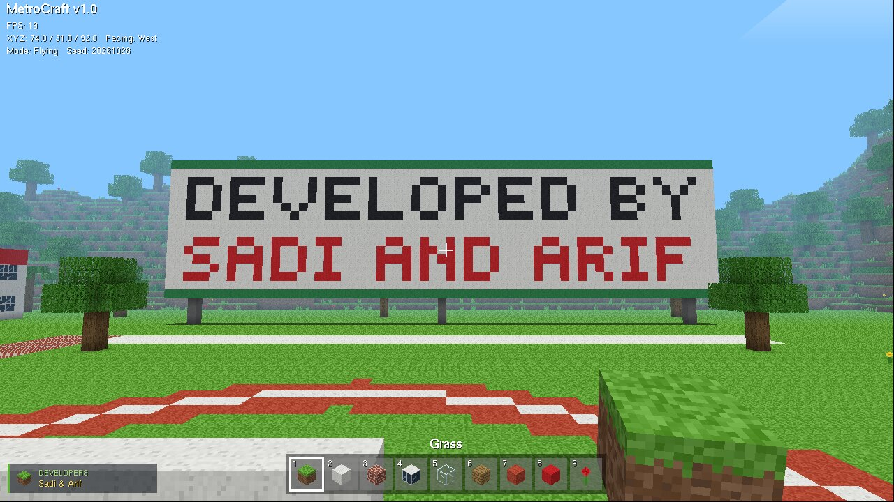<br><sub>Our names beside the field</sub></td>
</tr>
<tr>
<td align="center">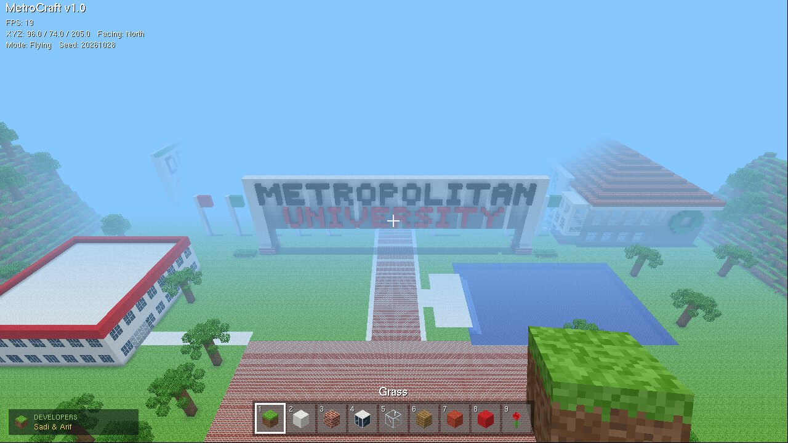<br><sub>The entrance from the air</sub></td>
<td align="center">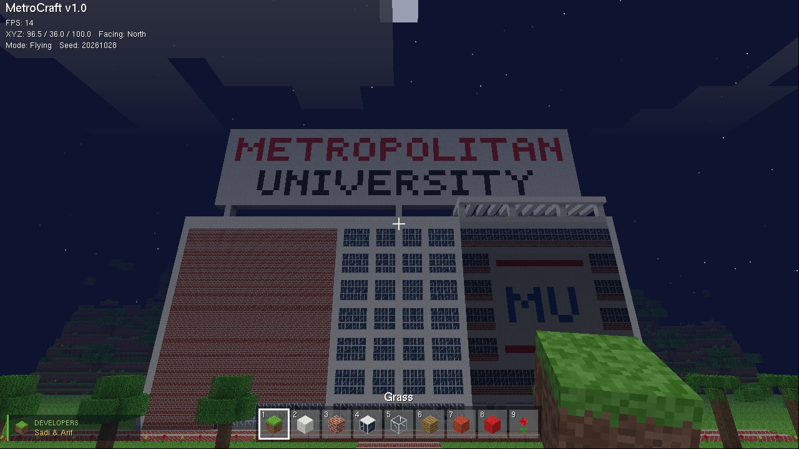<br><sub>The main building at night</sub></td>
</tr>
<tr>
<td align="center">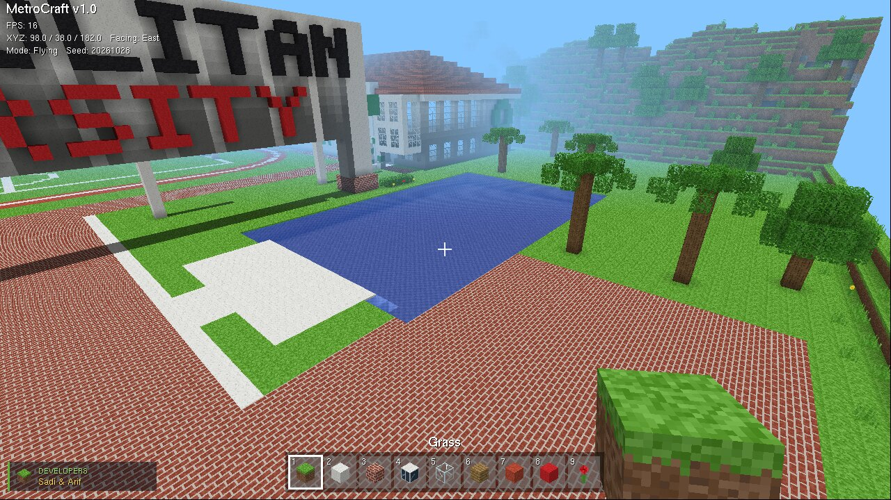<br><sub>The pond and its ghat</sub></td>
<td align="center">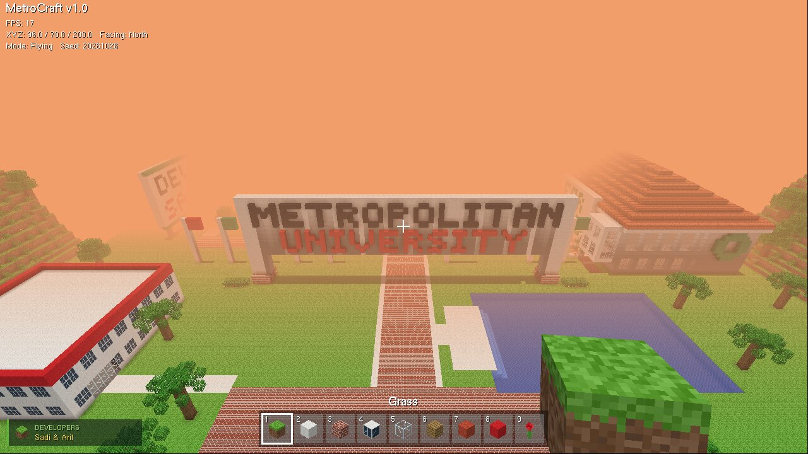<br><sub>The entrance at sunset</sub></td>
</tr>
</table>
</div>

## How the code is laid out

The file you read first is **`src/main.cpp`, exactly 100 lines**: the window, the OpenGL settings, the camera, the draw order of a frame, the game loop and the input. Everything else lives in **`lib/`**, a small engine that `main.cpp` calls into.

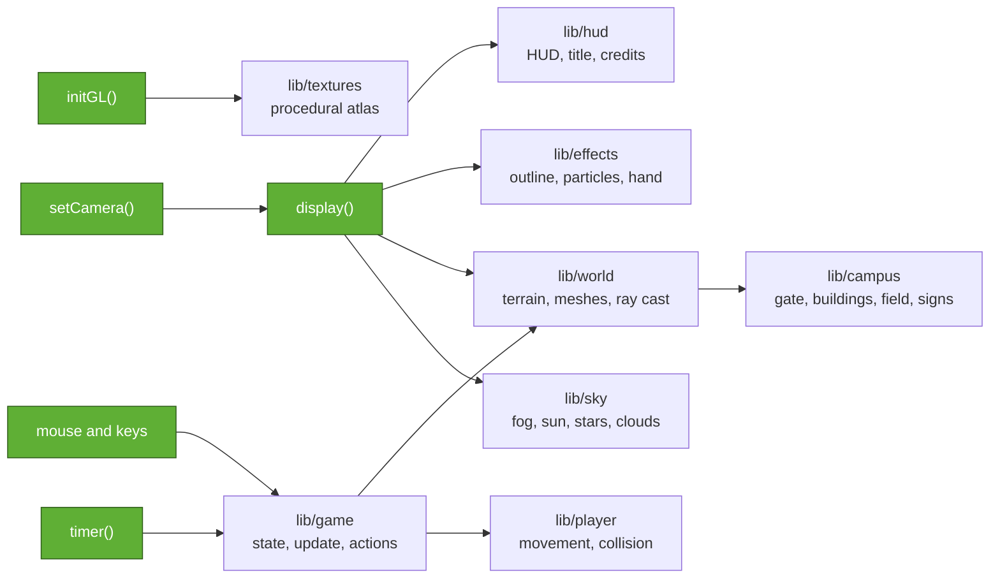

Green boxes are functions in `src/main.cpp`; the rest are files in `lib/`. Here is the whole frame, copied straight from `main.cpp`:

```cpp
void display() {
    clearSky();                                          // clear colour and depth buffers
    setCamera();
    drawSky();
    glEnable(GL_TEXTURE_2D);                             // solid blocks, with texture and alpha test
    glBindTexture(GL_TEXTURE_2D, game.atlas);
    glEnable(GL_ALPHA_TEST);
    game.world->drawOpaque(game.view.x, game.view.z);
    glDisable(GL_ALPHA_TEST);
    RayHit hit = lookAt();                               // the block under the crosshair
    if (game.screen == PLAYING) { drawSelection(hit); drawParticles(); }
    drawClouds();
    glEnable(GL_TEXTURE_2D);                             // water last, blended with what is behind it
    glEnable(GL_BLEND);
    glDepthMask(GL_FALSE);
    game.world->drawWater(game.view.x, game.view.z);
    glDepthMask(GL_TRUE);
    glDisable(GL_BLEND);
    drawOverlay(hit);                                    // 2D layer: HUD, or the title screen
    glutSwapBuffers();                                   // double buffering: show the finished frame
}
```

Solid blocks go first with the depth test on. Water goes last with blending on and depth writes off, so you see the pond floor through it. The 2D layer goes on top, and the finished frame is swapped onto the screen in one go.

<details>
<summary><b>Where each graphics idea lives</b></summary>
<br>

| Graphics idea | Where to find it |
|---|---|
| Perspective projection | `gluPerspective` in `setCamera()`, `src/main.cpp` |
| Viewing transform | `glRotatef` and `glTranslatef` by the negative eye position, `setCamera()` |
| Orthographic 2D overlay | `gluOrtho2D` in `ortho()`, `lib/hud.cpp` |
| Modelling with primitives | every block is 6 faces of 2 triangles, `emitFace()` in `lib/world.cpp` |
| Procedural modelling | the campus built by loops in `lib/campus.cpp` |
| Texture mapping, atlas UVs | `buildAtlas()`, `tileUV()` in `lib/textures.cpp` |
| Texture animation | `animateWater()` with `glTexSubImage2D`, `lib/textures.cpp` |
| Hidden-surface removal | depth test and culling in `initGL()`, `faceVisible()` in `lib/world.cpp` |
| Ambient occlusion | `cornerAO()` in `lib/world.cpp` |
| Transparency | alpha test for leaves, glass and plants, blending for water, both in `display()` |
| Billboards | particles turned to face the camera in `drawParticles()`, `lib/effects.cpp` |
| Retained-mode geometry | one display list per chunk per pass, `lib/world.cpp` |
| Picking | `World::raycast()` voxel traversal, called from `mouseButton()` |
| Vector and bitmap text | `glutStrokeString` for titles, `glutBitmapString` for the HUD, `lib/hud.cpp` |

</details>

The full walkthrough, from "what is OpenGL" to every function in the project, is in **[docs/GUIDE.md](docs/GUIDE.md)**. To find the code behind any shape on screen (a cube, the buildings, the letters, the track, particles, the sun, the hotbar icons, the logo), the **[code map](docs/CODE_MAP.md)** lists each one with its OpenGL primitive, file and line.

<details>
<summary><b>Project layout</b></summary>

```
MetroCraft/
├── src/
│   └── main.cpp              the 100 lines: window, OpenGL setup, camera, frame, loop, input
├── lib/                      the engine main.cpp calls into
│   ├── campus.h / .cpp       the campus: gate, main building, Centre For Excellence, signs, field, track, pond, flags, trees
│   ├── world.h / .cpp        block grid, campus ground and hills, caves, ore, meshes, lighting, ray cast, save/load
│   ├── game.h / .cpp         shared state, world start, per-frame update, key actions
│   ├── player.h / .cpp       movement, gravity, swimming, collision
│   ├── textures.h / .cpp     procedural texture atlas and water animation
│   ├── sky.h / .cpp          sky colour, fog, sun, moon, stars, clouds
│   ├── effects.h / .cpp      block outline, break particles, the block in your hand
│   ├── hud.h / .cpp          HUD, title screen, developer credits, screenshots
│   ├── blocks.h              block types and their textures
│   └── noise.h               2D and 3D value noise
├── tests/world_test.cpp      reproducibility, world and campus checks
├── tools/record.sh           re-records the GIFs from the game
├── docs/
│   ├── GUIDE.md              the complete guide
│   ├── CODE_MAP.md           which file and line draws each shape
│   └── media/                banner, map, GIFs and screenshots
├── deps/                     freeglut headers and import library for Windows builds
├── open_in_codeblocks.bat    one double-click to set up and open on Windows
├── MetroCraft.cbp            Code::Blocks project (Release and Tests targets)
├── CITATION.cff              how to cite this project
├── CMakeLists.txt
├── Makefile
└── LICENSE
```

</details>

## Controls

| Key | Action | | Key | Action |
|---|---|---|---|---|
| Mouse | Look around | | F | Fly on / off |
| W A S D | Move | | T | Day, sunset, night |
| Space | Jump, climb stairs, swim up, fly up | | F2 | Save a screenshot |
| Ctrl | Sprint | | F3 | Debug info |
| Shift | Fly down | | F5 / F9 | Save / load world |
| Left click | Break block | | N | New random world |
| Right click | Place block | | H or F1 | Controls panel |
| Middle click | Pick the block you look at | | I | About the developers |
| 1 to 9, wheel | Choose block | | Esc | Free mouse, again for the menu |

## Running it

### Windows with Code::Blocks

1. Download the repository as a ZIP (green **Code** button, then **Download ZIP**) and unzip it, or clone it:
   ```
   git clone https://github.com/RejaulKorimSadi/MetroCraft.git
   ```
2. Double-click **`open_in_codeblocks.bat`** inside the folder.
3. When Code::Blocks opens, press **F9**.

The freeglut headers and import library are already in the repository under `deps\`, so the project always compiles. The only thing the game needs at run time is `libfreeglut.dll`. The first time, the script installs Code::Blocks (with its MinGW compiler) and the freeglut package through `winget`, which takes a few minutes. After every build, Code::Blocks copies the DLL into `bin\` by itself. Nothing is copied into Program Files.

If Code::Blocks asks which compiler to use, pick **GNU GCC Compiler**. To run the world tests, switch the target drop-down from **Release** to **Tests** and press F9 again.

<details>
<summary>Setting it up by hand instead</summary>

1. Install Code::Blocks with MinGW (`codeblocks-25.03mingw-setup.exe` from codeblocks.org).
2. Install the freeglut DLL: install MSYS2, then run `pacman -S mingw-w64-ucrt-x86_64-freeglut`.
3. Open `MetroCraft.cbp` and press F9. The build copies `C:\msys64\ucrt64\bin\libfreeglut.dll` into `bin\`.

| Problem | Fix |
|---|---|
| `GL/freeglut.h: No such file or directory` | the `deps` folder is missing; unzip the whole repository again |
| "libfreeglut.dll was not found" when the game starts | install the freeglut package (step 2), or copy `libfreeglut.dll` into `bin` |
| "Can't find compiler executable" | install the Code::Blocks version with "mingw" in its name |

</details>

### Linux

```bash
sudo apt install g++ make freeglut3-dev
make run        # build and play
make test       # run the world tests
```

or with CMake: `cmake -S . -B build && cmake --build build && ctest --test-dir build`

## Reproducibility

The same seed always gives the same world, block for block. The campus is the same in every world; the seed changes the hills, caves and trees around it. The default seed is `20261028`, and you can pass another one when starting: `metrocraft 12345` (the seed shows on the title screen and in the F3 info).

`tests/world_test.cpp` checks this without opening a window. It builds the world twice and compares a fingerprint of all 2.9 million blocks, then checks the terrain, ores, caves, the campus landmarks, lighting, ray casting, and that a saved world loads back exactly.

```
MetroCraft world tests (seed 20261028)
  world fingerprint: 196F2779
  [PASS] the same seed builds the same world twice
  ...
  [PASS] the campus is there: field, road, pond, and the main building with its brick panel
  [PASS] the roof sign, the developer board, the gate and the Centre For Excellence are written in blocks
  [PASS] the Centre For Excellence has its tiled roof and glass upper floor
  ...
  reference fingerprint 196F2779: matches
all checks passed
```

The reference fingerprint was taken with GCC 13.3 on x86-64. A different compiler can round a float differently and produce a slightly different world. If that happens the test says so but doesn't fail.

Everything in `docs/media` came from the game itself with seed `20261028`: the clips and screenshots at 1280 × 720, and the campus map from the top block of every column. On Linux, `tools/record.sh` records the clips again: it starts the game on a virtual screen, replays a list of key presses and mouse moves, and saves the result as a GIF (it needs Xvfb, xdotool and ffmpeg).

## References

- John Amanatides and Andrew Woo, *A Fast Voxel Traversal Algorithm for Ray Tracing*, Eurographics 1987. Used for block picking.
- Mikola Lysenko, [*Ambient occlusion for Minecraft-like worlds*](https://0fps.net/2013/07/03/ambient-occlusion-for-minecraft-like-worlds/), 0fps.net, 2013. Used for the corner shadows and the quad-flip rule.
- [freeglut](https://freeglut.sourceforge.net/), for the window, input and fonts.

## Authors

<table>
<tr>
<td align="center" width="50%">
<b>Md Rejaul Korim Sadi</b><br>
ID 231-115-349<br>
CSE 58th Batch, Section I
</td>
<td align="center" width="50%">
<b>Kazi Abu Jafor Arif</b><br>
ID 231-115-068<br>
CSE 58th Batch
</td>
</tr>
</table>

Department of Computer Science & Engineering, Metropolitan University, Sylhet. Built for CSE 402 Computer Graphics & Image Processing Lab, taught by Shrabanti Chowdhury, Lecturer, Department of EEE.

If you use or build on MetroCraft, GitHub's **Cite this repository** button (from `CITATION.cff`) gives you a ready-made citation.

<sub>MetroCraft is a student project. The campus is our own block-by-block interpretation of Metropolitan University, Sylhet, made for a course at the university; it is not an official university product. The game is inspired by Minecraft by Mojang Studios, is not affiliated with or endorsed by Mojang or Microsoft, and uses none of their code, textures or assets. Released under the MIT License.</sub>
